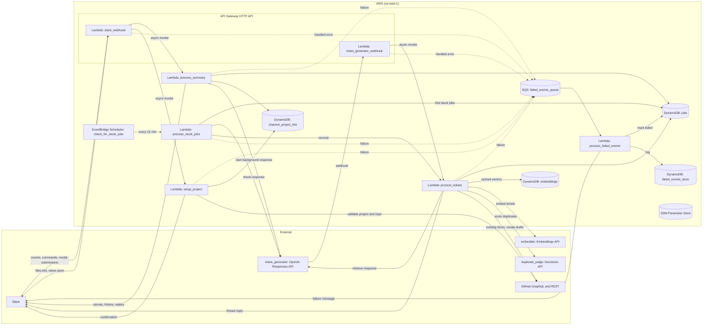
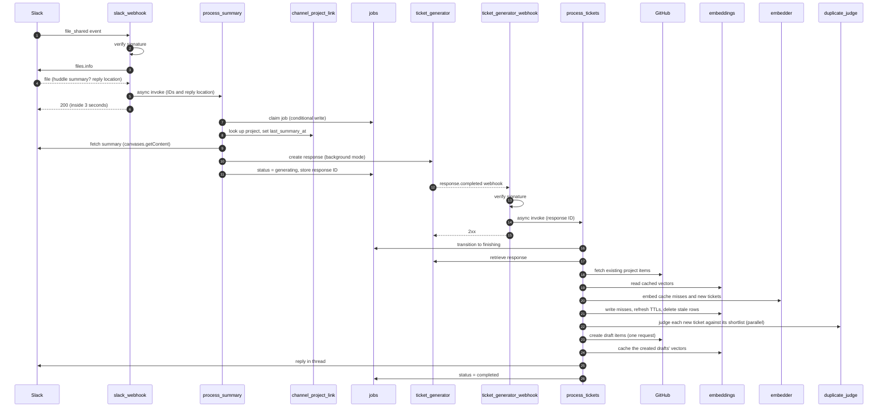
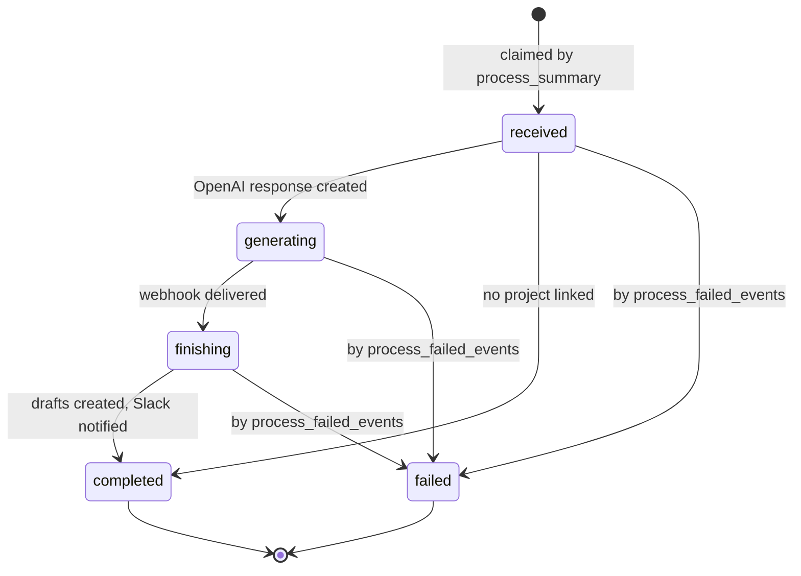
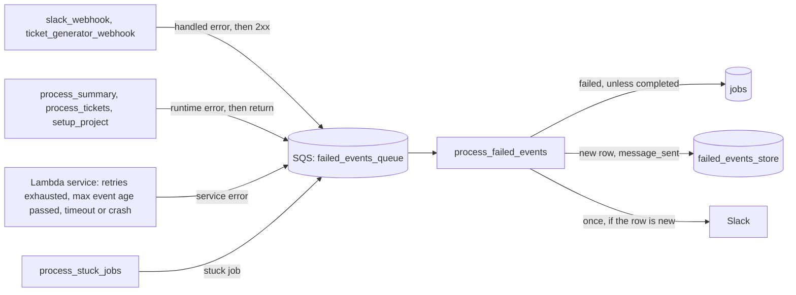

# Huddle Ticket Automation: Architecture

**Status:** Draft v0.6 · **Last updated:** 2026-11-26 · **Scope:** high-level architecture. Detailed designs (schemas, IAM policies, Terraform modules) live in separate documents. The code is being migrated to this version; [python-refactor-plan.md](python-refactor-plan.md) tracks the work.

---

## 1. Purpose

When Slack posts an AI-generated huddle summary to a channel (or a user runs `/meetingsummary`), this system:

1. extracts action items from the summary with an LLM,
2. drops any that duplicate tickets already in the channel's GitHub Project, and
3. adds the rest to that Project as **draft items** for manual review.

Today this runs as three n8n workflows (`transcription`, `setup`, `transcription-error-handler`), where the LLM both extracts tickets and drops duplicates in a single prompt that is given the existing tickets' titles and summaries. This document describes the target: **Python Lambdas on AWS**, deployed with **Terraform**, with selected components later rewritten in **Rust**.

## 2. Goals, constraints and non-goals

### Goals

- **Low cost.** Idle cost is approximately zero; per-run infrastructure cost is a fraction of a cent. LLM tokens are the dominant cost.
- **Self-hosted per organisation.** Each organisation deploys its own stack with Terraform and its own Slack app.
- **Language-neutral components.** Any Lambda can be rewritten in Rust without changing the others.
- **Production-grade.** Verified requests, idempotent processing, no stored transcripts, observable failures.

### Constraints

- Slack requires an acknowledgement within 3 seconds; OpenAI webhooks require a 2xx within a few seconds.
- GitHub integration uses a dedicated bot account with a classic personal access token (PAT), because user-owned Projects v2 are not reachable via fine-grained tokens or GitHub Apps. **User-owned projects only.**
- Users of a deployment are trusted members of one organisation.
- One environment for now.

### Non-goals (for now)

Multi-tenant hosting, organisation-owned projects, several repos per project, a UI, multiple environments, Zero Data Retention (ZDR) support.

## 3. System overview



The contract-level diagram, with every schema as a labelled arrow, is `contracts/schemas/schema_architecture.drawio` (moving to `docs/`).

### Public routes (API Gateway HTTP API)

| Route | Slack app setting or caller | Receives | Handled by |
|---|---|---|---|
| `POST /events` | Events request URL | `url_verification` handshake and `file_shared` events | `slack_webhook` |
| `POST /meeting_summary` | `/meetingsummary` command URL | the manual summary command | `slack_webhook` |
| `POST /setup` | `/setup` command URL | the setup command | `slack_webhook` |
| `POST /modals` | Interactivity request URL | the setup modal submission | `slack_webhook` |
| `POST /tickets_generated` | OpenAI webhook endpoint | `response.*` events | `ticket_generator_webhook` |

Routes follow Slack's payload types. Slack gives an app exactly one Events URL (every subscribed event and the URL handshake arrive there), one Interactivity URL (every modal submission and interactive component) and one URL per slash command. `/events` dispatches on the event type and `/modals` on the view's `callback_id`, so new event types or components are added there. Each route is one handler that loads only what it needs: the URL handshake needs only the signing secret, `file_shared` and `/setup` need the bot token, and `/modals` needs the GitHub URL parser but no Slack call.

The default API Gateway URL is used; no custom domain is required. There is **no VPC and no load balancer**.

## 4. Components

| Component | Trigger | Responsibility |
|---|---|---|
| **slack_webhook** | API Gateway (the four Slack routes) | Verify the Slack signature and timestamp over the raw body on every route. `/events`: answer the URL-verification challenge; for `file_shared`, call `files.info` and hand off only files that are Slack-generated huddle summaries, with the message's `ts`/`thread_ts` for the reply, and ignore every other file. `/meeting_summary`: hand off the summary text and reply in the channel with an acknowledgement carrying a short job reference. `/setup`: open the setup modal with `views.open` inside the `trigger_id` window. `/modals`: hand the submission to `setup_project`. Hand-offs are asynchronous invocations of `process_summary` or `setup_project`; the Lambda returns as soon as the invocation is accepted and never waits on the user. Everything, including `files.info` and `views.open`, fits in Slack's 3 seconds. |
| **ticket_generator_webhook** | API Gateway (`/tickets_generated`) | Verify the webhook signature (Standard Webhooks headers). Asynchronously invoke `process_tickets` with `{response_id, event_type}`. Return 2xx only after Lambda has accepted the invocation. |
| **process_summary** | Async invoke (from `slack_webhook`) | Claim the job (conditional write). Look up the channel's project; if none, tell the user to run `/setup` and complete the job; otherwise record `last_summary_at` on the link. Huddle path: fetch the summary with `canvases.getContent`; the reply location came in the hand-off. Manual path: slash commands carry no message timestamp, so find `slack_webhook`'s in-channel acknowledgement (it includes the job reference) with `conversations.history` and reply in its thread, falling back to the channel if it never appears. Start a **background** OpenAI response with the ticket-extraction prompt and structured-output schema. Record the response ID and move the job to `generating`. |
| **process_tickets** | Async invoke (from `ticket_generator_webhook` or `process_stuck_jobs`) | Move the job to `finishing` (conditional transition, so duplicate deliveries are harmless). Retrieve the response. Fetch the project's existing Issues and DraftIssues from GitHub (paginated; pull requests and archived items are excluded). Sync the embedding cache, embed the new tickets, shortlist the most similar candidates for each new ticket, and judge each new ticket against its shortlist in parallel (§7, *Duplicate detection*). Create draft items, each with a `## Summary` section, for tickets that are not duplicates, in one GraphQL request, and cache their embeddings under the returned item IDs. Reply in the Slack thread and mark the job `completed`. A failed, cancelled or incomplete generation is a failure (§5.5). |
| **setup_project** | Async invoke (from `slack_webhook`) | After the modal is submitted: validate the project URL and repo URL, confirm the bot can write to the project, accept a pending repo invitation if present, upsert the channel→project link, confirm in the channel. Problems the user can fix are explained in the channel and are not failures. |
| **process_failed_events** | SQS (`failed_events_queue`) | The only component that fails jobs and posts failure messages (§5.5). Mark the job `failed` unless it has completed, write a permanent row to `failed_events_store`, and, only when that row is new, post one failure message. |
| **process_stuck_jobs** | EventBridge Scheduler (`check_for_stuck_jobs`, every 15 minutes) | Find jobs neither `completed` nor `failed` 30 minutes after they were created. Recover a `generating` job whose OpenAI response has completed by invoking `process_tickets`; send every other one to `failed_events_queue` (§5.6). |

Hand-offs between Lambdas use **asynchronous Lambda invocation**. A Lambda stops running as soon as it returns, so work that must continue after a response runs in a separately invoked function. The caller invokes the next function with `InvocationType=Event`, receives an immediate acknowledgement that the event was accepted, and returns. Lambda holds the event and retries failed runs (two retries). After the final retry, or once the event is older than the **maximum event age of 10 minutes**, Lambda sends its on-failure record to the workers' destination, `failed_events_queue`. Delivery is at-least-once, which the conditional writes in §5.4 already tolerate.

## 5. Key flows

### 5.1 Huddle summary to draft tickets



A file that is not a huddle summary is answered with 200 at step 4 and never becomes a job.

### 5.2 Manual summary (`/meetingsummary`)

Arrives at `/meeting_summary`. `slack_webhook` replies in the channel with an acknowledgement carrying a short job reference and hands the summary text to `process_summary` in the invocation payload. From the claim onward the flow matches §5.1, except that the text is not fetched from Slack and the reply goes in the acknowledgement's thread. Both paths produce the same job shape.

### 5.3 Project setup (`/setup`)

1. `slack_webhook` receives `/setup` at `/setup`, opens a modal with `views.open` explaining what is needed and why (project URL, repository URL), and returns. Nothing waits for the user.
2. Whenever the user submits, Slack posts the submission to `/modals` as a new request; `slack_webhook` asynchronously invokes `setup_project` and acknowledges with an empty 200, which closes the modal.
3. `setup_project` validates access, accepts a pending repo invitation if present, stores the link, and confirms in the channel.

The modal (rather than command arguments) is deliberate: it documents the requirements for the user and leaves room for a richer in-Slack form later.

### 5.4 Job lifecycle



Every transition is a **conditional write**. A duplicate invocation or webhook delivery that finds the job has moved on fails the condition and is dropped, so every step is safe to retry. Claiming the job and moving it to `generating` are separate writes: the claim comes first so a duplicate delivery is dropped before any LLM call, and the response ID only exists once the response has been created. While `process_summary` or `process_tickets` works on a job it holds a **lease** (`claimed_at` while `received`, `finishing_started_at` while `finishing`). A delivery that meets a live lease raises a retryable `LeaseHeld` and is retried by Lambda; once the lease has expired or been released, the retry takes the job over and resumes it.

Only `process_failed_events` moves a job to `failed`, and nothing moves a job out of `failed` or `completed`. So a Lambda retry still pending when a job is failed finds it `failed` and drops itself.

### 5.5 Failures

Every server-side failure takes one path, so users hear about each failed job exactly once and every failure is logged permanently. User-side problems (an unverified or malformed request, a setup URL the user can fix) are answered directly and never enter this path.



The queue is transport only. Two message shapes arrive, each with its own schema named for its final reader, and `process_failed_events` normalises both into one failure:

- `runtime_error_to_process_failed_events`: a failure one of our Lambdas recognised and sent itself, with the job's ID, the sender, a short reason code, the channel and the thread if known. Never summary text.
- `service_error_to_process_failed_events`: the Lambda service's on-failure record for an async invocation that failed for good. Its shape is AWS's, not ours.

1. **Entry points** (`slack_webhook`, `ticket_generator_webhook`): a handled error after verification is sent as a runtime error and the request is answered with **2xx**, so the sender does not retry it. Only unexpected or transient errors (including a rejected async invoke or a failed `files.info` call) are answered with **5xx**, so Slack or OpenAI retries the request. Entry points are not invoked asynchronously, so they never produce service errors.
2. **Workers** classify errors (`python_common.failures`). A permanent one (for example GitHub refusing a request, or a generation that failed) is sent as a runtime error and the worker returns normally, so Lambda does not retry. A retryable one releases the lease and is re-raised for Lambda's retries; if those run out, the Lambda service sends a service error. Workers never mark jobs failed or post failure messages. If the send to the queue itself fails, the worker treats it as retryable.
3. **`process_failed_events`** handles each message once:
   - Skip a service error whose final error is `LeaseHeld`: another run owns the job.
   - Mark the job `failed` with the reason, in one conditional write that is refused if the job has `completed` (then stop). A failure with no job row, such as one from `setup_project` or an entry point, carries on.
   - Create the `failed_events_store` row, only if its `id` is new. If it exists, stop: the failure was already handled, so a redelivered message never posts twice.
   - Post one message, in the thread if known, otherwise in the channel. Summary failures ask the user to check the project and run `/meetingsummary`; resharing a huddle file does not work, because its job ID is already taken. Setup failures ask the user to run `/setup` again.
   - Record whether the message was sent (`message_sent`). A Slack error is logged and never retried: failed runs are not critical, since a user can always rerun.

Every huddle job is a confirmed summary, because `slack_webhook` checks the file before handing it off, so a failure message is never posted about an unrelated file. A channel with no project ends the job as `completed` without a failure.

### 5.6 Stuck jobs

EventBridge Scheduler (`check_for_stuck_jobs`) runs `process_stuck_jobs` every 15 minutes. It reads every job that is neither `completed` nor `failed` and was created more than **30 minutes** ago:

| Job state | Action |
|---|---|
| `generating`, and OpenAI reports the response completed | Invoke `process_tickets` to finish it, recovering a lost or late webhook |
| Any other stuck job (`received`, `finishing`, or `generating` whose response failed, is still running, or could not be checked) | Send it to `failed_events_queue` |

The 30-minute cutoff relies on the workers' **maximum event age of 10 minutes**. Each stage then ends its retries within about 13 minutes, including a final run at its Lambda timeout, which leaves a few minutes for generation. So no original Lambda retry should still be pending or running when a job is failed for being stuck. If either value changes, revisit both.

Accepted edge cases: a webhook that arrives after its job was failed is dropped; and a recovery or run still in progress when its job is failed may still create drafts, so the user can see both drafts and a failure message.

## 6. Data model

DynamoDB, on-demand billing. No transcripts are ever written to DynamoDB.

### `channel_project_link`

| Attribute | Type | Notes |
|---|---|---|
| `channel_id` (PK) | string | Slack channel |
| `project_id` | string | GitHub Project node ID |
| `last_summary_at` | string (ISO 8601, UTC) | When a summary was last received for this project's channel. Set by `process_summary` with an update (not an overwrite) so it never clobbers `project_id` |
| (metadata) | | Optional fields such as `updated_at` |

### `jobs`

| Attribute | Type | Notes |
|---|---|---|
| `job_id` (PK) | string | Doubles as the dedupe key. Huddle path: the Slack `file_id`. Manual path: lowercase hex `sha256(channel_id + ':' + trigger_id)`. Revisit once real Slack payloads confirm `file_id` is stable across Slack's double post |
| `status` | string | `received`, `generating`, `finishing`, `completed`, `failed` |
| `source` | string | `huddle` or `manual` |
| `channel_id`, `thread_ts` | string | Where to reply |
| `project_id` | string | Copied from the link at claim time |
| `response_id` | string | Indexed by a GSI so `process_tickets` and `process_failed_events` can look the job up |
| `error` | string | Failure reason, set by `process_failed_events` |
| `created_at`, `ttl` | number | Unix seconds. `process_stuck_jobs` measures age from `created_at`; rows expire after 30 days |
| `claimed_at` | number | Unix seconds when `process_summary`'s claim lease (90 s) started; removed on release |
| `finishing_started_at` | number | Unix seconds when `process_tickets`'s lease (180 s) started; removed on release |

### `failed_events_store`

The permanent failure log, written only by `process_failed_events`, one row per failure. **No TTL.** It never holds summary text, invocation payloads or raw error messages.

| Attribute | Type | Notes |
|---|---|---|
| `id` (PK) | string | The job ID; for a failure with no job (`setup_project`, an entry point), the request ID. Created with a conditional put, so each failure is handled once |
| `sender` | string | The Lambda that failed: `slack_webhook`, `ticket_generator_webhook`, `process_summary`, `process_tickets`, `setup_project` or `process_stuck_jobs` |
| `reason` | string | A short code: the sender's error code (e.g. `github_forbidden`, `generation_failed`), `<condition>:<errorType>` for a service error (e.g. `RetriesExhausted:GitHubUnavailable`, with `Unknown` as the error type when Lambda reports none), or `stuck_<status>` |
| `channel_id`, `thread_ts` | string | Where the message went; `thread_ts` only if known |
| `failed_at` | number | Unix seconds when `process_failed_events` logged it |
| `message_sent` | boolean | `false` when the row is created, `true` once Slack accepts the failure message; a failed post leaves it `false` and is not retried |

### `embeddings`

A disposable cache of embedding vectors for existing project items, so each run embeds only new or changed tickets. Any row can be lost without harm: a missing row is a cache miss and is re-embedded.

| Attribute | Type | Notes |
|---|---|---|
| `project_id` (PK) | string | GitHub Project node ID; one Query returns a project's whole cache |
| `item_id` (SK) | string | Project item node ID (`PVTI_…`), the same for drafts we create and items added by hand |
| `text_hash` | string | Lowercase hex SHA-256 of the item's embed text (§7). A different hash means the title or summary was edited, so the row is a miss |
| `embedding` | binary | The vector as little-endian float32 values |
| `embedding_model`, `dimensions` | string, number | The model and dimension count the vector was made with. A mismatch with the current SSM values is a miss, so changing either re-embeds lazily with no migration |
| `ttl` | number | Unix seconds; DynamoDB deletes the row after it. Set to 180 days ahead on write, and pushed back to 180 days ahead whenever a run finds less than 90 days left. Both values are code constants |

Rows are written for cache misses, refreshed as above, and deleted when their `item_id` is no longer among the project's items. Deletion happens only after the paginated GitHub fetch has completed, so a partial fetch never deletes rows. The table holds vectors and hashes derived from ticket text, never the text itself.

### Configuration (SSM Parameter Store)

| Type | Parameters |
|---|---|
| SecureString | Slack signing secret, Slack bot token, GitHub PAT, OpenAI API key, OpenAI webhook secret, duplicate-judge API key, embeddings API key |
| String | Duplicate threshold, generation model name, judge model name, embedding model name (initially `text-embedding-3-small`), embedding dimensions (initially 256), shortlist size K (initially 10), shortlist minimum similarity (initially 0.5) |

Secret values are kept in GitHub Actions secrets and written to SSM by the deploy workflow (§12). The String values are Terraform variables. Lambdas fetch parameters on first use and cache them in the execution environment.

## 7. Integrations and seams

Each external dependency sits behind a small interface so it can be faked in tests, swapped for another vendor, or reimplemented in Rust one adapter at a time.

| Interface | Purpose | Initial adapter | Possible swaps |
|---|---|---|---|
| `TicketGenerator` | Start and retrieve a background generation | OpenAI Responses API (GPT Luna) | Another vendor; synchronous mode |
| `Embedder` | Turn ticket texts into vectors, in batches | OpenAI embeddings API (`text-embedding-3-small`, 256 dimensions) | Another embeddings vendor; AWS Bedrock |
| `DuplicateJudge` | Score a new ticket against its shortlisted candidates, returning a probability per pair | OpenAI's Decisions API | Another classifier; plain LLM |
| `GitHubClient` | Read project items (paginated; titles and bodies of Issues and DraftIssues, excluding pull requests and archived items), create a run's draft items in one request (one aliased `addProjectV2DraftIssue` per draft), validate project write access (`viewerCanUpdate`), list and accept repo invitations | GitHub GraphQL and REST | |
| `SlackClient` | Fetch file info and canvas content, read channel history, post messages, open modals | Slack Web API | |
| `JobStore`, `LinkStore`, `EmbeddingStore`, `FailedEventStore` | Persistence | DynamoDB | |
| `FailureQueue` | Send a failure to `process_failed_events` | SQS (`failed_events_queue`) | |
| `Config` | Secrets and settings | SSM Parameter Store | |

### Duplicate detection

Duplicate checking is deliberately **separate from ticket generation**. The generation call no longer carries existing tickets. Instead, a two-stage funnel runs in `process_tickets`:

1. **Shortlist by embeddings (recall).** Every ticket is embedded, and cosine similarity picks the few plausible matches for each new ticket. This stage is cheap and only rules out clearly unrelated tickets.
2. **Judge the shortlist (precision).** OpenAI's Decisions API reads the new ticket and each shortlisted candidate together and returns the probability that they describe the same work. A probability at or above the duplicate threshold (SSM) is a duplicate.

The two stages fail differently: embeddings measure topic, so "Add dark mode" and "Fix dark mode contrast bug" score as similar, while the judge can tell related tickets from duplicates. The threshold, K and the minimum similarity are starting values, adjusted by hand in configuration.

**Draft body format.** Every draft `process_tickets` creates has the body `## Summary\n\n{summary}\n\n{body}`, where `summary` and `body` come from the extracted ticket. The `## Summary` section is a core part of the design: it is what duplicate detection compares. The extraction schema (and the model generated from it) makes the section parse back exactly: `summary` is one line with no CR or LF that starts with neither whitespace nor `#`, and `body` must start with `#`, so the section always ends at the body's first heading.

**Embed text.** Every ticket, new or existing, is compared through one text, built the same way everywhere:

- The title, trimmed, then a blank line, then the summary, trimmed: `{title}\n\n{summary}`. If there is no summary, the text is the title alone.
- Both parts are capped before joining: trim, keep the first N Unicode code points (256 for the title, GitHub's own limit; 1,500 for the summary), then trim the end again. The longest embed text is therefore 1,758 code points, at most 7,032 UTF-8 bytes, which keeps it under the embeddings API's 8,192-token input limit (its tokenizer never produces more tokens than bytes).
- A new ticket's summary is its `summary` field.
- An existing item's summary is the section under the first line that is exactly `## Summary` (trailing whitespace ignored), up to the next line starting with `#` or the end of the body. Line endings are normalised to `\n` first. An item with no such heading, or an empty section, has no summary, so only its title is compared. This includes `## 1. Summary` headings from n8n-era tickets and issues written by hand.
- The summary in a draft we created must parse back **exactly** to the ticket's `summary`, so the text (and hash) `process_tickets` caches when it creates a draft equals the text the next run builds from GitHub.
- The same text (capped) is embedded, hashed for the cache (§6) and sent to the judge.

**Algorithm** (per `process_tickets` run):

1. **Embed.** Build the embed text for each existing item and look it up in the cache. Embed the misses and all new tickets in batched calls, then update the cache (§6).
2. **Shortlist.** For each new ticket, the candidate pool is the existing items plus every other new ticket. Keep the K most similar candidates (K = 10 initially) whose cosine similarity is at least the minimum (0.5 initially). Both values live in SSM. An empty shortlist means no judge call and no duplicate.
3. **Judge in parallel.** One Decisions request per new ticket with a non-empty shortlist: the new ticket is the `input`, and each candidate is one predicate question named by its ID. Requests run concurrently, with a small fixed concurrency cap. There is no overall time budget: each request has its own timeout.
4. **Resolve in extraction order.** Walk the new tickets in the order the model extracted them. A ticket is a **duplicate** if its normalised title equals that of an existing item or an earlier kept ticket, or if it scores at or above the threshold against an existing item, or against an earlier kept ticket in either direction (its own request, or the earlier ticket's request). Otherwise it is kept. So when two new tickets duplicate each other, the later one is dropped. A ticket that matches only an earlier *dropped* ticket is kept.
5. **Create and cache.** Create drafts for all kept tickets in one GraphQL request, then write their vectors to the cache under their new item IDs, so the next run does not re-embed them.

**No partial-success tracking.** The request is not a transaction: GitHub can create some drafts and then return an error or time out. Any error fails the run as a whole, retryable or permanent as usual. A retry fetches the project again, so the title check in step 4 skips the drafts an earlier attempt created (they appear in the reply as duplicates). Nothing records which drafts a run created.

**Failure handling (fail open).** Drafts are reviewed by people, so a failed check creates tickets rather than losing them:

- Embeddings API failure: skip steps 2–3; only the title checks in step 4 apply.
- A Decisions request fails, or one answer is a refusal or missing: those pairs are unscored and count as not duplicates. Other tickets' requests are unaffected, and a pair can still be caught by the other ticket's request.
- Cache read or write failure: proceed as if every item were a miss, and skip the cache writes. The cache never fails a run.

## 8. Contracts and language neutrality

"Language-neutral" means the contracts between components do not depend on Python:

- **Contracts live outside code.** Every exchange (between our Lambdas, with storage, and with each external API) is a JSON Schema file in `contract-schemas/`. **One schema per call**: a request and its response are separate schemas.
- **Models are generated from the schemas.** The pydantic models are generated with `datamodel-code-generator` and committed; they are never edited by hand. Rust will generate serde types the same way (`typify`). A check fails if regenerating would change the committed models (a pre-commit hook and CI, in the CI/CD phase). Behaviour a schema cannot express (cross-field checks, the embed text, vector packing, keeping payloads out of `repr`) lives in hand-written code beside the generated models, and the shared model settings (strict, frozen, input hidden from errors) on a hand-written base class.
- **Schema naming rule (project-wide).** A schema is named `<operation>_to_<destination>` in snake_case: what the payload is, then who receives it. A request and its response can therefore name different operations, each describing its own payload (`add_tickets_to_github`, then `ticket_ids_to_process_tickets`). Destinations are our Lambdas by name, storage as `db_<table>`, Slack and GitHub by vendor name, and swappable vendor seams by role (`ticket_generator`, `embedder`, `duplicate_judge`), so a vendor swap does not rename a contract. A response is `confirm_receipt_to_<destination>` only when nothing in its body is used; `confirm_receipt_to_slack` is the one shared schema for an empty 200 to Slack. A queue is transport, never a destination.
- **Class names are schema names.** Every generated class is its schema's name in PascalCase (`add_job_to_db_jobs` → `AddJobToDbJobs`); there are no separate domain names.
- **Schemas describe what we rely on.** Schemas for payloads we receive describe only the fields we read and allow any others; schemas for payloads we send are exact.
- **No shared fixtures or test vectors for now.** Tests are unit tests (§13). Logic that must match across languages (Slack signature verification, Standard Webhooks verification, job-ID derivation, the embed text and its hash) is small and specified in this document; shared vectors can be reintroduced before the Rust port (§16).
- **Deployment is runtime-agnostic.** One Terraform `lambda_function` module takes runtime, handler and artifact as variables (Python on a Python runtime; Rust as a `bootstrap` binary on `provided.al2023`). Use arm64 for both.
- **State is stored in language-neutral shapes** (plain strings, numbers, lists, and little-endian float32 bytes for vectors).

### Schemas

| Directory | Schemas |
|---|---|
| `internal/lambda_to_lambda` | `handoff_to_process_summary`, `handoff_to_setup_project`, `handoff_to_process_tickets` (from `ticket_generator_webhook` and `process_stuck_jobs`), `runtime_error_to_process_failed_events`, `service_error_to_process_failed_events` |
| `internal/lambda_to_db` | `add_job_to_db_jobs`, `update_job_to_db_jobs`, `check_stuck_jobs_to_db_jobs`, `stuck_jobs_to_process_stuck_jobs`, `linked_project_to_db_channel_project_link`, `linked_project_to_process_summary`, `add_project_to_db_channel_project_link`, `ticket_embeddings_to_db_embeddings`, `failed_events_to_db_failed_events_store` |
| `external/slack` | Inbound: `url_verification_to_slack_webhook`, `automatic_summary_to_slack_webhook`, `manual_summary_to_slack_webhook`, `setup_command_to_slack_webhook`, `setup_form_to_slack_webhook`. Our replies: `url_verification_to_slack`, `summary_response_to_slack`, `confirm_receipt_to_slack`. Web API: `file_info_to_slack` / `file_info_to_slack_webhook`, `setup_form_to_slack` (`views.open`) / `confirm_receipt_to_slack_webhook`, `canvas_content_to_slack` / `canvas_content_to_process_summary`, `conversation_history_to_slack` / `conversation_history_to_process_summary`, `send_message_to_slack` / `confirm_receipt_to_lambdas` |
| `external/ticket_generator` | `summary_to_ticket_generator` / `receipt_id_to_process_summary` (create), `completion_notice_to_ticket_generator_webhook` / `confirm_receipt_to_ticket_generator` (webhook), `get_tickets_to_ticket_generator` / `tickets_to_process_tickets` (retrieve), `check_response_finished_to_ticket_generator` / `finished_responses_to_process_stuck_jobs` (status check) |
| `external/embedder` | `embed_tickets_to_embedder` / `embeddings_to_process_tickets` |
| `external/duplicate_judge` | `tickets_to_duplicate_judge` / `duplicate_results_to_process_tickets` |
| `external/github` | `existing_tickets_to_github` / `existing_tickets_to_process_tickets`, `add_tickets_to_github` / `ticket_ids_to_process_tickets`, `check_project_writeable_to_github` / `check_project_writeable_to_setup_project`, `check_repo_visible_to_github` / `check_repo_visible_to_setup_project`, `check_repo_invite_to_github` / `check_repo_invite_to_setup_project`, `accept_repo_invite_to_github` / `accept_repo_invite_to_setup_project` |

**The extracted-ticket format** is sent to OpenAI verbatim as the structured-output format, so it stays a plain, strict-mode root schema in its own file and is read at runtime by `process_summary`. The response envelopes have their own schemas (`receipt_id_to_process_summary`, `tickets_to_process_tickets`); they refer to the format rather than nest it. The format file's name is open (§16).

### Repository layout (target)

```
.
├── CLAUDE.md
├── README.md
├── docs/                   # architecture.md, python-refactor-plan.md, diagrams
├── contract-schemas/
│   ├── internal/
│   │   ├── lambda_to_lambda/
│   │   └── lambda_to_db/
│   └── external/
│       ├── slack/
│       ├── github/
│       ├── ticket_generator/
│       ├── embedder/
│       └── duplicate_judge/
├── prompts/                # versioned LLM prompts
├── src/                    # all deployable Python code
│   ├── lambdas/
│   │   ├── slack_webhook/
│   │   ├── ticket_generator_webhook/
│   │   ├── process_summary/
│   │   ├── process_tickets/
│   │   ├── setup_project/
│   │   ├── process_failed_events/
│   │   └── process_stuck_jobs/
│   └── python_common/      # shared helpers, plus the generated models
├── tests/                  # mirrors src/ (and scripts/)
├── slack/                  # app manifest template (derive from the current slack-bot-manifest.json)
├── infra/
│   ├── bootstrap/          # one-time: Terraform state bucket
│   └── terraform/
│       └── modules/        # lambda_function, failure_queue, schedule, http_api, tables, ssm_parameters
└── scripts/                # build, packaging and model generation
```

## 9. Security

- **Request verification.** Every public route verifies its signature over the raw request body before doing any work: Slack's signing secret plus timestamp window on the four Slack routes, the Standard Webhooks signature on `/tickets_generated`. Unverified requests are rejected with 4xx and never reach an LLM or the failure queue.
- **Least-privilege IAM per Lambda.** For example, `ticket_generator_webhook` can read only the webhook secret, invoke `process_tickets` and send to `failed_events_queue`; `slack_webhook` can read the Slack signing secret and bot token and invoke `process_summary` and `setup_project`; only `process_summary`, `process_tickets` and `process_stuck_jobs` can read the OpenAI key; only `process_tickets` can read the judge and embeddings keys and the `embeddings` table; only `process_failed_events` can write `failed_events_store`. Because `slack_webhook` handles every Slack route, the code that answers file events can read the bot token; that is acceptable under the trusted-organisation model, and the token is loaded only on routes that call the Web API.
- **Secrets** live in SSM Parameter Store (SecureString). Terraform creates the parameters with placeholder values and ignores later changes; the real values come from GitHub Actions secrets and are written by the deploy workflow, so they never enter Terraform state.
- **No stored transcripts.** DynamoDB holds IDs, status, failure reason codes, and (in `embeddings`) vectors and hashes derived from ticket titles and summaries, which already live in GitHub. It never holds transcript or summary text. Embeddings can be partly inverted back into text; that is an accepted risk, since the source text is ticket content rather than transcripts. Transcript text is never logged. On the manual path the summary text travels in the invocation payload, which Lambda holds for at most the 10-minute maximum event age. If the run fails for good, Lambda copies that payload into `failed_events_queue`. `process_failed_events` deletes the message once handled and never copies the payload into `failed_events_store`, but a message it cannot handle stays in the queue for the default 4-day retention. That short-lived copy is an accepted exception.
- **OpenAI retention.** The background response is created with `store=true`, so OpenAI keeps the response, including the summary input, for at least 30 days. With `store=false` it would be deleted after about 10 minutes, but `process_tickets` must be able to retrieve it whenever the webhook arrives, and `process_stuck_jobs` checks it 30–45 minutes after the job started (§5.6). Robust retrieval was chosen over shorter retention. "No stored transcripts" still holds for our own storage (DynamoDB and logs). Background mode is also not ZDR-compatible. Both are acceptable today (no retention requirement), and are one reason generation sits behind the `TicketGenerator` interface.
- **Draft-only output.** Tickets are created as draft items for human review. The LLM has no tools and its output is schema-constrained, which limits the impact of prompt injection from meeting content or existing tickets.
- **GitHub token scope.** The classic PAT needs `repo` and `project` scopes, which is broad. A dedicated bot account limits the blast radius. Because users are trusted, any workspace member can link a channel to any project the bot can access. This is an accepted limitation of the trusted-organisation model.

## 10. Reliability and failure modes

| Failure | Handling |
|---|---|
| Slack retries or posts the summary twice | Both reach `process_summary`. Its conditional claim drops the second once the first has moved the job on; if the second arrives while the first still holds its claim lease, it raises `LeaseHeld` and Lambda retries it, and the retry is then dropped (or resumes the job if the first run died). |
| Slack 3-second deadline | The Slack routes only verify, call `files.info` or `views.open` where needed, and hand off. If they are slow, Slack retries the request, and the job ID drops the duplicate. |
| `files.info` fails at `slack_webhook` (rate limit, Slack error) | Return 5xx; Slack retries the event (up to three times). |
| Async invoke is rejected at an entry point (for example throttled) | Return 5xx; the sender retries. 2xx is returned only after Lambda accepts the invocation. |
| An entry point meets a handled error after verification | Send it to `failed_events_queue` and return 2xx (§5.5). |
| Duplicate OpenAI webhook delivery (at-least-once) | `process_tickets`'s conditional transition drops duplicates. |
| OpenAI delivers the webhook late, or never | `process_stuck_jobs` checks the response 30–45 minutes after the job started: it recovers a completed one through `process_tickets`, and fails the job otherwise (§5.6). A webhook arriving after the job failed is dropped. |
| Generation fails, is cancelled or incomplete | The webhook subscribes to these events too; `process_tickets` sends the failure to `failed_events_queue`, and `process_failed_events` tells the thread. |
| A worker meets a permanent error (for example a revoked GitHub token) | The worker sends it to `failed_events_queue` and returns; `process_failed_events` fails the job, logs it and tells the user once (§5.5). |
| A worker crashes, times out or keeps hitting retryable errors | Lambda retries (two retries, within the 10-minute maximum event age). Steps are idempotent: a retry's title check skips drafts an earlier attempt created. After that, the Lambda service sends its record to `failed_events_queue` and on to `process_failed_events`. |
| `process_failed_events` itself fails | SQS redelivers the message until it succeeds or the 4-day retention expires. No dead-letter queue or alarm: failures are not critical, as users can rerun. A failed Slack post is logged in `failed_events_store` (`message_sent = false`) and not retried. |
| Channel has no project configured | Reply asking the user to run `/setup` (before any LLM call). The job completes; it is not a failure. |
| Duplicate judge unavailable | **Fail open** per request: the affected pairs count as not duplicates, other tickets keep their verdicts, and the thread notes it. Drafts are reviewed anyway. |
| Embeddings API unavailable | **Fail open:** no shortlist or judge calls; only exact-title duplicates are dropped, and the thread notes it. |
| `embeddings` table unavailable | Treated as an empty cache: everything is embedded and nothing is written. The run is not failed. |

Alert routing is deferred; `failed_events_store` is the failure log.

## 11. Cost

Estimates at list prices (verify before relying on them); excludes LLM tokens.

| Item | Estimate |
|---|---|
| Infrastructure per run (a few Lambda-seconds, DynamoDB, API Gateway) | ≈ $0.025 per 1,000 runs |
| Fixed monthly infrastructure | ≈ $0 (free tiers, standard SSM parameters, on-demand DynamoDB, small log volume, a Terraform state bucket holding a few kilobytes) |
| HTTP API | ≈ $1 per million requests |
| Stuck-job schedule | ≈ $0: EventBridge Scheduler's free tier is 14 million invocations a month (then $1 per million); every 15 minutes is about 2,900. The scans and occasional OpenAI checks are a few Lambda-seconds each |
| Failure queue | ≈ $0: a few SQS requests per failure |
| Embeddings (counted here, though they are LLM tokens) | Negligible: a ticket's embed text is about 100 tokens, and the cache means only new or edited tickets are embedded. The cache's storage is about 1 KB per item at 256 dimensions |

Deliberately avoided: an Application Load Balancer (roughly $16+/month idle), a VPC with a NAT gateway (roughly $32+/month), and Secrets Manager (about $0.40 per secret per month, with rotation we cannot use because none of our providers support it). Set explicit CloudWatch log retention to avoid unbounded log growth.

## 12. Infrastructure and deployment

- **Terraform** with remote state in S3. Recent Terraform versions support S3-native state locking, removing the need for a DynamoDB lock table (confirm the minimum version when implementing). A one-time `bootstrap` stack creates the state bucket.
- **Modules:** `lambda_function` (role, log group with retention, function, optional async-invoke settings: two retries, a 10-minute maximum event age and the `failed_events_queue` destination), `failure_queue` (the queue with default retention, no dead-letter queue, and the event source mapping to `process_failed_events`), `schedule` (EventBridge Scheduler `check_for_stuck_jobs`, every 15 minutes, to `process_stuck_jobs`), `http_api`, DynamoDB tables, SSM parameters.
- **Configuration.** Non-secret settings (model names, thresholds, K, dimensions) are Terraform variables written to the SSM String parameters. Secret values are stored as GitHub Actions secrets; the deploy workflow authenticates to AWS with GitHub OIDC (no stored AWS keys) and writes them to the SecureString parameters with `aws ssm put-parameter --overwrite` after `terraform apply`, never as Terraform variables.
- **Build:** a script builds Python zips (and later Rust binaries) before `terraform apply`; CI takes over at the CI/CD stage.

### First deployment (order matters)

1. Apply `bootstrap`, then the main stack. Outputs include the API base URL.
2. Create the Slack app from the manifest template **without** request URLs; install it; add the signing secret and bot token to GitHub Actions secrets.
3. Register the webhook URL in the OpenAI dashboard, subscribe to the `response.*` terminal events, and add the webhook secret and the API keys to GitHub Actions secrets.
4. Run the deploy workflow so the secrets reach SSM (until CI/CD exists, set them with the AWS CLI).
5. Set the Slack request URLs: the Events URL to `/events`, the `/meetingsummary` command URL to `/meeting_summary`, the `/setup` command URL to `/setup`, and the Interactivity URL to `/modals`. Slack verifies the Events URL, so `slack_webhook` must answer the URL-verification challenge and its signing secret must already be in SSM.
6. Create the GitHub bot account and PAT; invite the bot to the channels, projects and repos to connect.

Steps 2, 3 and 6 are manual and belong in the README. Later deployments need no manual secret handling: the secrets are already in GitHub.

The current `slack-bot-manifest.json` already carries the bot scopes (`canvases:read`, `channels:history`, `channels:read`, `chat:write`, `commands`, `files:read`, `groups:history`, `groups:read`), the `file_shared` event and both slash commands, all with empty URLs. The target manifest additionally needs interactivity enabled (for the setup modal submission) and its request URL, and its `long_description` should stop referring to n8n.

## 13. Observability and testing

- **Logging:** structured JSON with `job_id` as the correlation ID. Python uses AWS Lambda Powertools (Logger, Parameters, Metrics); Rust will use `tracing`. Idempotency is hand-rolled via conditional writes (portable) rather than Powertools' idempotency utility.
- **Failure log:** every failure is a permanent row in `failed_events_store` (§6), with its reason and whether the user was told. There are no alarms for now; alert routing is deferred.
- **Testing:** strict unit tests only, with fakes behind the interfaces in §7 and inline test data; no shared fixture or vector files. The generated models are kept in line with the schemas by regeneration, not by tests. Real-AWS integration tests are defined at the CI/CD stage.

## 14. Delivery roadmap

1. **Python on AWS.** Migrate the code to this design ([python-refactor-plan.md](python-refactor-plan.md)), then implement the seven Lambdas against the contracts. Recommended: deploy a walking skeleton early (`slack_webhook` answering Slack's challenge) to validate the Slack and OpenAI handshakes before the full logic exists. Cut over from n8n using a test channel and project.
2. **Terraform.** Modules and first-deployment procedure as in §12.
3. **Rust.** Suggested order: `ticket_generator_webhook` (smallest, a few-seconds deadline), then `slack_webhook` (3-second deadline, where cold starts matter), then the workers.
4. **CI/CD.** Build, test, deploy pipeline: the model-regeneration check (pre-commit hook and CI), secrets from GitHub Actions to SSM over OIDC; separate environments considered here.
5. **UI.** HTTP API supports JWT authorizers for when it is needed.
6. **Maintain, optimise, add features.**

## 15. Decision log

| # | Decision | Alternatives considered | Rationale |
|---|---|---|---|
| 1 | Lambdas + DynamoDB | Always-on EC2 | Pay per use; near-zero idle cost |
| 2 | API Gateway HTTP API; no ALB, no VPC | ALB, REST API, VPC | Cheapest; security comes from request verification and IAM, not networking |
| 3 | Background mode + webhook for the slow LLM call | Synchronous worker; polling; Step Functions; Batch API | Lowest per-run cost (no idle billing); accepted trade-offs: not ZDR-compatible, manual webhook registration. A lost or late event is covered by the stuck-job check (decision 30) |
| 4 | SSM Parameter Store | Secrets Manager | Free; our secrets cannot use automatic rotation |
| 5 | Language-neutral contracts; Powertools in the Python phase | Shared Python library | Enables incremental Rust port |
| 6 | Separate, calibrated duplicate decision | Duplicates judged inside generation | Cheaper; tunable threshold; vendor-pluggable |
| 7 | Bot account with classic PAT | GitHub App; OAuth app | Only option that reaches user-owned Projects v2 |
| 8 | Self-hosted per organisation, one environment, `us-east-1` | Multi-tenant SaaS | Simplest model; cheapest region |
| 9 | Hand-rolled idempotency via conditional writes | Powertools idempotency utility | Portable to Rust |
| 10 | Modal-based `/setup` | Command arguments | Self-documenting; extensible to a richer Slack form |
| 11 | One entry-point Lambda per external caller: `slack_webhook` for all Slack traffic, `ticket_generator_webhook` for OpenAI | One Lambda per public endpoint (`summary-posted`, `project-added`, `issues-generated`); one Lambda for every route | Simpler code: the Slack routes share verification and the hand-off. The cold-start cost is negligible (both former Slack Lambdas loaded the same libraries) and secrets load lazily per route. Reverses the earlier one-Lambda-per-endpoint choice |
| 12 | Routes per Slack payload type: `/events`, `/meeting_summary`, `/setup`, `/modals`; `/tickets_generated` for OpenAI | Routes grouped by function (`/slack/summary`, `/slack/newproject`); one route per event type | Slack fixes one Events URL and one Interactivity URL per app, and each route then handles one body format |
| 13 | Asynchronous Lambda invocation for hand-offs, with one shared on-failure destination (`failed_events_queue`) | An SQS queue plus DLQ per consumer; HTTP calls between Lambdas; self-invocation | A Lambda stops when it returns, so post-response work needs its own invocation. Async invoke gives automatic retries and failure capture with far fewer resources. A visible backlog and per-hop concurrency caps are not needed at this scale (revisit if they become necessary, see §16) |
| 14 | OpenAI's Decisions API as the duplicate judge | Jev; a plain LLM prompt | Per-pair probabilities with a tunable threshold; same vendor and account as generation |
| 15 | Embedding shortlist before the judge: top K (10) above a minimum cosine similarity (0.5), one predicate per shortlisted candidate in one request per new ticket | Judge every candidate; one combined "duplicate of any of these?" predicate; lexical similarity (BM25, token overlap) | Bounds the judge's input regardless of project size; keeps per-candidate probabilities and the matched ticket's ID; embeddings catch reworded duplicates that lexical methods miss |
| 16 | Embedding cache in DynamoDB (`embeddings`), keyed by project and item, validated by a hash of the embed text plus model and dimensions; 180-day TTL refreshed once under 90 days remain; rows for items no longer in the project are deleted after a complete fetch | No cache; S3 object per project; GitHub `updatedAt` for staleness | DynamoDB as the single source of truth for state. The hash re-embeds only real title or summary edits, while `updatedAt` also changes on status, priority and assignee edits. The cache is disposable, so expiry is aggressive |
| 17 | Every draft body starts with a `## Summary` section, and duplicate detection matches exactly that heading; items without it are compared by title alone | Parse several heading styles; compare the whole body | One schema going forward. Exact round-tripping keeps the cache's hashes stable for drafts we create |
| 18 | Judge new tickets in parallel, then resolve in extraction order (the later of two duplicate new tickets is dropped); no overall time budget | Sequential judging against earlier kept tickets, under a time budget | Shortlists keep each request small, so per-request timeouts bound the run without a budget, and parallel requests cut latency |
| 19 | Only Issues and DraftIssues are read from a project; every other item type (pull requests, any future type, read as a plain string so it cannot fail the listing) and archived items are skipped | All project items | A PR is usually the work on a ticket, not a ticket. Archived items are treated as gone |
| 20 | A separate SSM secret for the embeddings API key | Reuse the OpenAI or judge key | Can be rotated, scoped and billed separately |
| 21 | Lambdas named `slack_webhook`, `ticket_generator_webhook` (entry points), `process_summary`, `process_tickets`, `setup_project` (workers), `process_failed_events`, `process_stuck_jobs` (failure handling); "ticket", not "issue", and roles, not vendors, where a name can be vendor-agnostic | `summary-posted`, `project-added`, `issues-generated`, `process-issues`, `job-failed`, `check-stale-jobs` | Entry points are named for who calls them, workers for what they process. Supersedes the earlier event-based names |
| 22 | Every schema is named `<operation>_to_<destination>` (§8); `confirm_receipt_*` only when the body is unused | `<sender>_to_<receiver>`; descriptive names | Names say what the payload is, so a request and its response can each be named for their content |
| 23 | Guarantee the `## Summary` round trip in the extraction schema: `summary` is one line not starting with whitespace or `#`, and `body` starts with `#` | Cache a new draft under the embed text parsed back from its own body; no constraint | The model's structured output enforces the rule, and the cached hash equals what the next run computes from GitHub |
| 24 | Cap the embed text's title (256 code points) and summary (1,500 code points) inside the shared embed-text rules | Truncate only the embeddings API input; accept over-long inputs and fail open | One over-long item can never disable the shortlist for its project, and the hash, the judge input and the cache all use the same capped text |
| 25 | No length limit on the extracted ticket's `title` in the schema | `maxLength: 256`; a length-limiting `pattern` | Strict structured outputs do not support `maxLength`; embed texts already cap titles, and GitHub rejects longer titles anyway |
| 26 | The extracted-ticket format is its own plain root schema; the OpenAI response envelopes get their own schemas that refer to it | One schema holding the envelope with the ticket format as a `$def`; no envelope schemas | The format is sent to OpenAI verbatim and strict mode rejects unsupported keywords, so it cannot be nested. With models generated from schemas, every payload we parse needs one |
| 27 | One failure path: our Lambdas send runtime errors to `failed_events_queue` and the Lambda service sends service errors there; only `process_failed_events` fails jobs and messages users | Each worker fails its own jobs and posts; an on-failure destination that invokes a Lambda directly; a queue that holds failures for manual replay | One place to fail jobs and word messages; the queue redelivers if `process_failed_events` errors; known and unexpected failures look the same to users and in the log |
| 28 | `failed_events_store` is a permanent failure log (no TTL), keyed by job ID (or request ID when there is no job); the message is sent only when the row is first created, and `message_sent` records the outcome; no dead-letter queue, no alarms, default 4-day queue retention | A short queue retention; a DLQ and alarm on the queue; retrying failed Slack posts | Failed runs are not critical: users can rerun. Creating the row first makes a redelivered message post nothing, and a lost post is logged rather than retried |
| 29 | Drafts are created in one GraphQL request, and partial success is not tracked anywhere: any error fails the run, and a retry's title check skips drafts already created | One request per draft, recording each created item ID on the job | Less code and state. The cost of a partial success is one retry. Rate limits are deliberately left as ordinary failures for now |
| 30 | `process_stuck_jobs` on EventBridge Scheduler every 15 minutes: any job neither `completed` nor `failed` 30 minutes after `created_at` is recovered (a completed `generating` response is finished) or failed | Accepting the lost-webhook risk; a daily check at 24 hours; a 15-minute cutoff | Covers lost webhooks and lost failure events promptly at no cost. 30 minutes clears each stage's retries under the 10-minute maximum event age (decision 31), so a pending Lambda retry is not failed under it; Lambda offers no way to ask whether an event is still queued for retry |
| 31 | Worker async settings: two retries, maximum event age 10 minutes | Defaults (two retries, 6 hours) | Bounds how long a job can be retrying, which the 30-minute stuck cutoff relies on, while still riding out brief 429s and 5xxs |
| 32 | `slack_webhook` checks with `files.info` that a shared file is a huddle summary before handing it off | A Slackbot-only pre-filter at the entry point and the real check in `process_summary` | Non-summary files never become jobs, and `process_failed_events` never needs to re-check a file. The merged Lambda has the bot token, and the summary's metadata is populated before the file is posted |
| 33 | One schema per call, in `contract-schemas/internal/` and `external/` by counterpart | Several calls per schema as `$def`s; a flat directory | Each schema describes exactly one payload, which suits model generation, and the layout shows where a contract sits |
| 34 | Pydantic models generated from the schemas and committed; class names are schema names | Hand-written models checked against fixtures; comparing `model_json_schema()` with the schemas | The schema is the single source, so models cannot drift; Rust can generate its types the same way |
| 35 | No shared fixtures or test vectors for now; strict unit tests only | Fixture files and cross-language vectors | Less to maintain while the design moves; vectors can return before the Rust port |
| 36 | Entry points answer a handled error with 2xx and send it to the failure queue; only unexpected or transient errors get 5xx | Never queue from entry points; 5xx on every error | The user hears about a known failure once, and Slack or OpenAI retries only what a retry can fix |
| 37 | Secrets in GitHub Actions secrets, written to SSM by the deploy workflow over OIDC; non-secret settings as Terraform variables | Setting secrets by hand on every build; secrets as Terraform variables | No manual secret handling after the first deployment, and secrets never enter Terraform state |
| 38 | No judge-threshold evaluation tooling; thresholds are set by hand in configuration | A labelled-pairs eval script | Less to maintain for now; tuning tooling can return if thresholds prove hard to set |

## 16. Deferred, open items and known issues

### Deferred (out of scope for this document)

- Alert routing (for example on `failed_events_store` growth)
- AWS tuning: reserved concurrency, budgets and alarms, throttling
- GitHub rate-limit handling (today a rate limit is an ordinary failure)
- The async payload size limit versus the longest manual summary (verify the current limit)
- Reintroducing SQS between hops if a visible backlog or per-hop concurrency caps are needed
- Shared test vectors for cross-language logic, before the Rust port
- Tooling for tuning the duplicate threshold and shortlist settings
- Separate environments, CI/CD, UI
- Showing suppressed duplicates to users
- Zero Data Retention support (would require synchronous generation)
- Organisation-owned projects and several repos per project
- Per-channel duplicate thresholds

### Open items to confirm

- **Shortlist minimum similarity.** 0.5 is a starting guess. A reworded duplicate can score below it, especially at 256 dimensions, and the judge never sees a candidate the shortlist drops. Lower it if real duplicates are missed.
- **Service-error records:** confirm the record's shape and `condition` values, and that the request ID it carries matches `context.aws_request_id` across retries (`setup_project` failures are keyed by it).
- **The extracted-ticket format's schema name**, and whether `tickets_to_process_tickets` refers to it by `$ref`.

### Known issues in the current n8n workflow (fix, do not port)

Re-verified against `n8n-workflows/*.json` on 2026-11-22; all are still present.

**`transcription.json`**

- **No pagination.** *Get Existing Project Tickets* queries `items(first: 100)` and never pages, so projects with more than 100 items are only partly compared. It reads Issue, DraftIssue and PullRequest titles and bodies.
- **Summary regex never matches.** *Extract Title and Summary* uses `## Summary\s*([^#]*)`, but the prompt's body template emits `## 1. Summary`. (The structured-output schema's `description` field says `## Summary`, so the prompt and schema disagree with each other too.) Result: the existing-ticket "summary" is always an empty string and the LLM compares titles only.
- **Wrong `thread_ts` on the slash-command path.** *Code in JavaScript1* sets `thread_ts` from the `x-slack-request-timestamp` header, which is the request time, not a message timestamp. Replies on this path therefore do not attach to the user's message. (On the huddle path it is correctly the file's message `thread_ts`/`ts`, but it is stored as a number, which risks precision loss on Slack timestamps.)
- **Racy duplicate window.** The per-channel lock (*Get Previous File Upload to Channel* → *Check if File Sent Last 10 Seconds* → *Upsert Record of File Upload*) is a read-then-write, not atomic, so two near-simultaneous events can both pass. It also silently drops any legitimate upload within 10 seconds of the previous one. It applies to the huddle path only.
- **Prompt defects.** The prompt contains paste artifacts (a stray `[11:23 AM]`, non-breaking spaces and run-together markdown) and tells the model to output "an empty JSON array" while the schema requires `{ "issues": [] }`.
- **Weak huddle filter.** *If1* only checks `user_id == USLACKBOT`; any Slackbot-shared file passes, not just huddle summaries. The target checks the file with `files.info` in `slack_webhook`.
- **No request verification.** The Slack trigger node and the two raw webhooks (`/meetingsummary`, `/setup`) do not verify Slack signatures (the README even says not to add a signing secret to the credential). The target verifies every request (§9).
- **Partial failures.** Drafts are created one at a time; a failure partway is reported only as a count ("N tickets encountered an error"), with no record of which were created, so a retry can duplicate them. In the target, a retry's title check skips drafts already created (§7).
- **Error handler coverage.** *transcription-error-handler* can reply in the thread only if *Get Upload Message Timestamp* ran, i.e. the huddle path after file lookup; other failures go to the channel root. It also emails via Gmail. The target handles every failure in `process_failed_events` (§5.5).

**`setup.json`**

- **Narrow URL parsing.** Only `https://github.com/users/<login>/projects/<n>` URLs match. The repository is assumed to be owned by the same login as the project (`GET /repos/{login}/{repo}` using the last URL segment).
- **Repo is validated but never stored or used.** The link table holds only `channel_id` and `project_id`. Duplicate detection reads project items, not the repo, so the README's statement that "only the one you enter here will be scanned for duplicate tickets" is inaccurate for the current workflow.
- **Invitation lookup not paginated.** `user/repository_invitations?per_page=100` reads one page.
- **Interaction model.** Setup uses an n8n *Send and Wait* form (60-minute limit) rather than a Slack modal; the modal is a target-design change (decision 10).

**Data tables.** The workflows use two n8n data tables (`slack_channel_lock`: `channel_id,last_upload_ts`; `slack_channel_project_link`: `channel_id,project_id`), matching the two schema CSVs. The README describes a single three-column table and should be corrected separately. In the target, the lock table is replaced by the `jobs` dedupe key and `last_summary_at` on the link (§6).

## 17. Glossary

- **Lambda:** a short-lived function billed per millisecond of execution.
- **HTTP API:** the cheaper API Gateway type that routes public HTTPS requests to Lambdas.
- **Async invocation:** invoking a Lambda without waiting for it to finish. Lambda accepts the event, returns immediately, runs it later and retries failures.
- **On-failure destination:** where Lambda sends a record of an asynchronous invocation that failed for good (the original payload, the error type and why it gave up); here, a service error.
- **SQS:** a message queue. Here it is only `failed_events_queue`, which carries every failure to `process_failed_events`.
- **EventBridge Scheduler:** AWS's managed cron service; its `check_for_stuck_jobs` schedule invokes `process_stuck_jobs` every 15 minutes.
- **Idempotent:** safe to run more than once with the same effect as running once.
- **Conditional write:** a DynamoDB write that succeeds only if a condition holds (for example "this row does not exist yet"); the basis of our dedupe and state transitions.
- **GSI:** global secondary index, which lets DynamoDB look up rows by an attribute other than the primary key.
- **TTL:** a DynamoDB feature that automatically deletes rows after a timestamp.
- **Embedding:** a fixed-length list of numbers representing a text, such that texts with similar meaning have nearby vectors.
- **Cosine similarity:** a score of how closely two vectors point the same way; for embeddings, a measure of how similar two texts are in meaning.
- **Webhook:** an HTTP call a service makes to you when something happens.
- **Standard Webhooks:** the signature scheme OpenAI uses (`webhook-id`, `webhook-timestamp`, `webhook-signature` headers).
- **SSM Parameter Store:** AWS's configuration and secrets store; SecureString parameters are KMS-encrypted.
- **Generated model:** a pydantic class produced from a JSON Schema by a code generator; never edited by hand.
