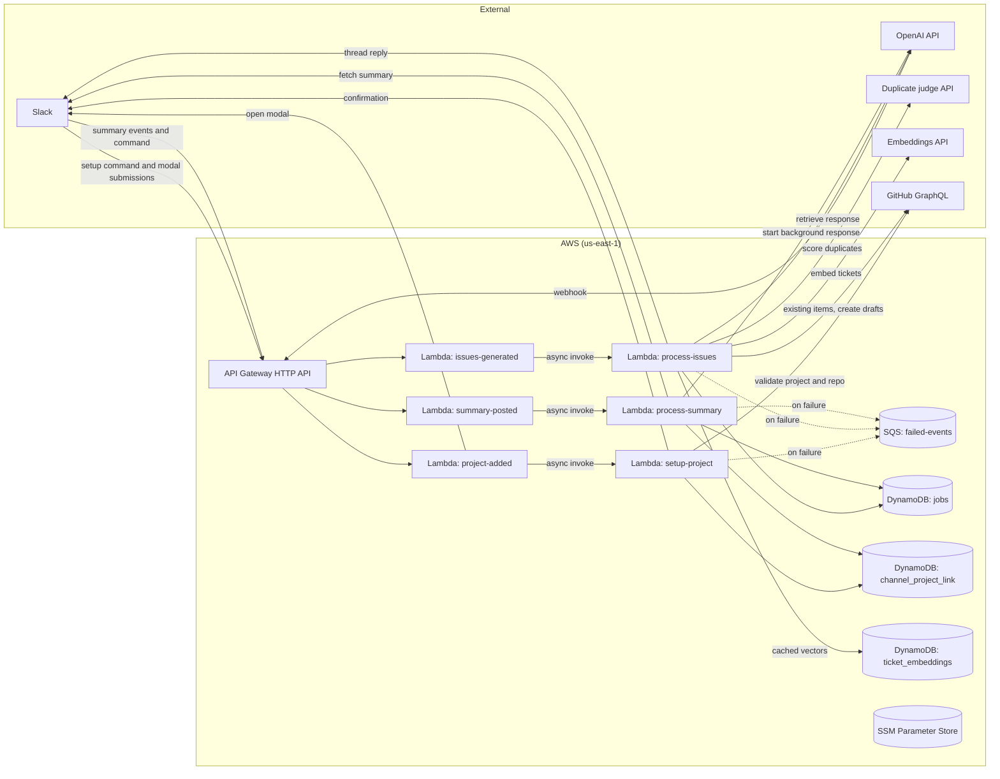
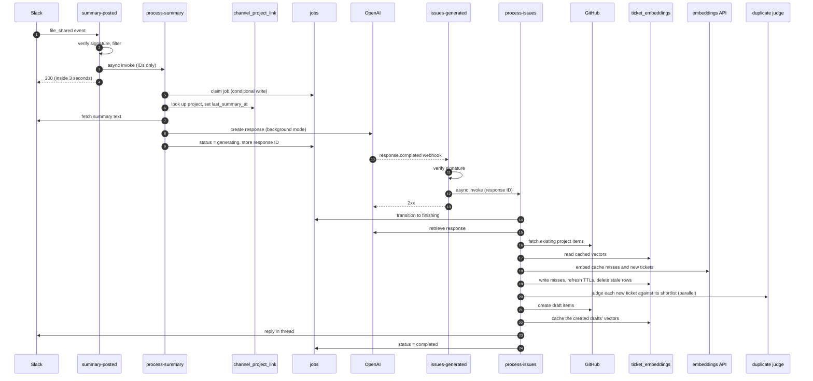
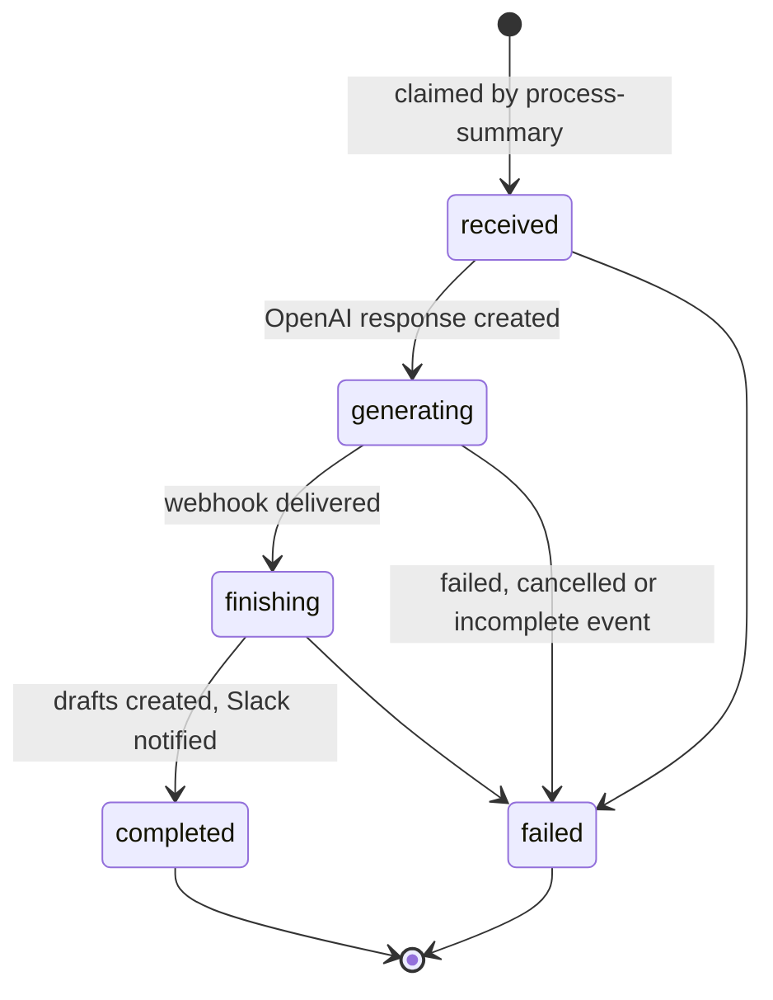

# Huddle Ticket Automation: Architecture

**Status:** Draft v0.3 · **Last updated:** 2026-11-23 · **Scope:** high-level architecture. Detailed designs (schemas, IAM policies, Terraform modules) live in separate documents.

---

## 1. Purpose

When Slack posts an AI-generated huddle summary to a channel (or a user runs `/meetingsummary`), this system:

1. extracts action items from the summary with an LLM,
2. drops any that duplicate tickets already in the channel's GitHub Project, and
3. adds the rest to that Project as **draft items** for manual review.

Today this runs as three n8n workflows (`transcription`, `setup`, `transcription-error-handler`), where the LLM both extracts tickets and drops duplicates in a single prompt that is given the existing tickets' titles and summaries. This document describes the target: **Python Lambdas on AWS**, deployed with **Terraform**, with selected components later rewritten in **Rust**.

## 2. Goals, constraints and non-goals

### Goals

- **Low cost.** Idle cost is approximately zero; per-run infrastructure cost is a fraction of a cent. LLM tokens are the dominant cost.
- **Self-hosted per organisation.** Each organisation deploys its own stack with Terraform and its own Slack app.
- **Language-neutral components.** Any Lambda can be rewritten in Rust without changing the others.
- **Production-grade.** Verified requests, idempotent processing, no stored transcripts, observable failures.

### Constraints

- Slack requires an acknowledgement within 3 seconds; OpenAI webhooks require a 2xx within a few seconds.
- GitHub integration uses a dedicated bot account with a classic personal access token (PAT), because user-owned Projects v2 are not reachable via fine-grained tokens or GitHub Apps. **User-owned projects only.**
- Users of a deployment are trusted members of one organisation.
- One environment for now.

### Non-goals (for now)

Multi-tenant hosting, organisation-owned projects, several repos per project, a UI, multiple environments, Zero Data Retention (ZDR) support.

## 3. System overview



### Public routes (API Gateway HTTP API)

| Route | Caller | Handled by |
|---|---|---|
| `POST /slack/summary` | Slack: `file_shared` events (the app's Events request URL) and the `/meetingsummary` slash command | `summary-posted` |
| `POST /slack/newproject` | Slack: the `/setup` slash command and the setup modal submission (the app's Interactivity request URL) | `project-added` |
| `POST /webhook` | OpenAI (`response.*` events) | `issues-generated` |

Routes are grouped by what they do, not by Slack payload type. Slack allows one Events request URL, one Interactivity request URL and a separate URL per slash command, so this mapping is configured in the Slack app manifest. The slash commands keep their user-facing names (`/meetingsummary`, `/setup`); only the URL paths differ.

`/slack/summary` receives two payload formats: JSON events and form-encoded slash-command payloads. A thin parser per format normalises both into one `summary_posted_to_process_summary` message, and verification and the hand-off are shared. Only the events format needs URL-verification handling and the huddle-summary filter, and only the slash command returns an in-channel acknowledgement.

A Slack app accepts only one URL for all event subscriptions and one for all interactive components, and both are pointed at the routes above. Every subscribed event therefore arrives at `/slack/summary`, and every interactive payload (such as a modal submission) arrives at `/slack/newproject`. If more event types or interactive components are added later, the handlers dispatch on event type or `callback_id` (or the routes are renamed).

The default API Gateway URL is used; no custom domain is required. There is **no VPC and no load balancer**.

## 4. Components

| Component | Trigger | Responsibility |
|---|---|---|
| **summary-posted** | API Gateway (`/slack/summary`) | Verify Slack signature and timestamp (raw body). Parse either a `file_shared` event or a `/meetingsummary` payload and normalise it into one `summary_posted_to_process_summary` message. For events: answer URL-verification challenges and ignore every file not shared by Slackbot (`user_id == USLACKBOT`), a cheap pre-filter, since the event carries no huddle fields and this Lambda holds only the signing secret. The authoritative huddle check runs in `process-summary`. Asynchronously invoke `process-summary` (IDs only on the huddle path, summary text on the manual path) and return immediately; the slash command also returns an in-channel acknowledgement. Needs the Slack signing secret only, not the bot token. |
| **project-added** | API Gateway (`/slack/newproject`) | Verify Slack signature and timestamp. On `/setup`, open the modal within Slack's `trigger_id` window. On modal submission, asynchronously invoke `setup-project` and acknowledge. Needs the signing secret and the bot token. |
| **process-summary** | Async invoke (from `summary-posted`) | Claim the job (conditional write). Look up the channel's project; if none, tell the user to run `/setup`; otherwise record `last_summary_at` on the link. Huddle path: resolve the file via `files.info` (channel and the message's `thread_ts`/`ts` from `shares`, public or private); if it is not a Slack-generated huddle summary, end the job quietly before any LLM call; otherwise fetch the summary text with `canvases.getContent`. Manual path: slash commands carry no message timestamp, so find `summary-posted`'s in-channel ack (it includes a short job reference) with `conversations.history` and thread replies under it, falling back to channel-level replies if it never appears. Start a **background** OpenAI response with the ticket-extraction prompt and structured-output schema. Record the response ID and move the job to `generating`. |
| **issues-generated** | API Gateway | Verify the webhook signature (Standard Webhooks headers). Asynchronously invoke `process-issues` with `{response_id, event_type}`. Return 2xx only after Lambda has accepted the invocation. |
| **process-issues** | Async invoke (from `issues-generated`) | Move the job to `finishing` (conditional transition, so duplicate deliveries are harmless). Retrieve the response. Fetch the project's existing Issues and DraftIssues from GitHub (paginated; pull requests and archived items are excluded). Sync the embedding cache, embed the new tickets, shortlist the most similar candidates for each new ticket, and judge each new ticket against its shortlist in parallel (§7, *Duplicate detection*). Create draft items, each with a `## Summary` section, for tickets that are not duplicates, and cache their embeddings. Reply in the Slack thread. Mark the job `completed` or `failed`. |
| **setup-project** | Async invoke (from `project-added`) | After the modal is submitted: validate the project URL and repo URL, confirm the bot can write to the project, accept a pending repo invitation if present, upsert the channel→project link, confirm in the channel. |

Hand-offs between Lambdas use **asynchronous Lambda invocation**. A Lambda stops running as soon as it returns, so work that must continue after a response runs in a separately invoked function. The caller invokes the next function with `InvocationType=Event`, receives an immediate acknowledgement that the event was accepted, and returns. Lambda holds the event, retries failed runs (up to two retries), and after the final retry or the maximum event age sends the event to a shared on-failure destination: the SQS queue `failed-events`. Retry settings, maximum event age and the failure queue's retention are configured per consumer function (values deferred, see §16). Delivery is at-least-once, which the conditional writes in §5.4 already tolerate.

## 5. Key flows

### 5.1 Huddle summary to draft tickets



### 5.2 Manual summary (`/meetingsummary`)

Enters through the same route as huddle summaries (`/slack/summary`) and is normalised into the same `summary_posted_to_process_summary` message. The flow is identical from step 3 onward, except the summary text arrives in the command payload (carried in the invocation payload) instead of being fetched from Slack. Both entry paths produce the same job shape.

### 5.3 Project setup (`/setup`)

1. `project-added` receives `/setup` at `/slack/newproject` and opens a modal explaining what is needed and why (project URL, repository URL).
2. The user submits; Slack posts the submission to the same route; `project-added` asynchronously invokes `setup-project` and acknowledges.
3. `setup-project` validates access, accepts a pending repo invitation if present, stores the link, and confirms in the channel.

The modal (rather than command arguments) is deliberate: it documents the requirements for the user and leaves room for a richer in-Slack form later.

### 5.4 Job lifecycle



Every transition is a **conditional write**. A duplicate invocation or webhook delivery that finds the job has moved on fails the condition and is dropped, so every step is safe to retry. While `process-summary` or `process-issues` works on a job it holds a **lease** (`claimed_at` while `received`, `finishing_started_at` while `finishing`). A delivery that meets a live lease raises a retryable `LeaseHeld` and is retried by Lambda; once the lease has expired or been released, the retry takes the job over and resumes it.

## 6. Data model

DynamoDB, on-demand billing. No transcripts are ever written to DynamoDB.

### `channel_project_link`

| Attribute | Type | Notes |
|---|---|---|
| `channel_id` (PK) | string | Slack channel |
| `project_id` | string | GitHub Project node ID |
| `last_summary_at` | string (ISO 8601, UTC) | When a summary was last received for this project's channel. Set by `process-summary` with an update (not an overwrite) so it never clobbers `project_id` |
| (metadata) | | Optional fields such as `updated_at` |

### `jobs`

| Attribute | Type | Notes |
|---|---|---|
| `job_id` (PK) | string | Doubles as the dedupe key. Huddle path: the Slack `file_id`. Manual path: lowercase hex `sha256(channel_id + ':' + trigger_id)`, pinned by `contracts/vectors/job_id.json`. Revisit once real Slack payloads confirm `file_id` is stable across Slack's double post |
| `status` | string | `received`, `generating`, `finishing`, `completed`, `failed` |
| `source` | string | `huddle` or `manual` |
| `channel_id`, `thread_ts` | string | Where to reply |
| `project_id` | string | Copied from the link at claim time |
| `response_id` | string | Indexed by a GSI so `process-issues` can look the job up |
| `created_item_ids` | list | Recorded as drafts are created, so a retry does not duplicate them |
| `error` | string | Failure reason, if any |
| `created_at`, `ttl` | number | Rows expire automatically |
| `claimed_at` | number | Unix seconds when `process-summary`'s claim lease (90 s) started; removed on release |
| `finishing_started_at` | number | Unix seconds when `process-issues`'s lease (180 s) started; removed on release |

### `ticket_embeddings`

A disposable cache of embedding vectors for existing project items, so each run embeds only new or changed tickets. Any row can be lost without harm: a missing row is a cache miss and is re-embedded.

| Attribute | Type | Notes |
|---|---|---|
| `project_id` (PK) | string | GitHub Project node ID; one Query returns a project's whole cache |
| `item_id` (SK) | string | Project item node ID (`PVTI_…`), the same for drafts we create and items added by hand |
| `text_hash` | string | Lowercase hex SHA-256 of the item's embed text (§7). A different hash means the title or summary was edited, so the row is a miss |
| `embedding` | binary | The vector as little-endian float32 values |
| `embedding_model`, `dimensions` | string, number | The model and dimension count the vector was made with. A mismatch with the current SSM values is a miss, so changing either re-embeds lazily with no migration |
| `ttl` | number | Unix seconds; DynamoDB deletes the row after it. Set to 180 days ahead on write, and pushed back to 180 days ahead whenever a run finds less than 90 days left. Both values are code constants |

Rows are written for cache misses, refreshed as above, and deleted when their `item_id` is no longer among the project's items. Deletion happens only after the paginated GitHub fetch has completed, so a partial fetch never deletes rows. The table holds vectors and hashes derived from ticket text, never the text itself.

### Configuration (SSM Parameter Store)

| Type | Parameters |
|---|---|
| SecureString | Slack signing secret, Slack bot token, GitHub PAT, OpenAI API key, OpenAI webhook secret, duplicate-judge API key, embeddings API key |
| String | Duplicate threshold, generation model name, judge model name, embedding model name (initially `text-embedding-3-small`), embedding dimensions (initially 256), shortlist size K (initially 10), shortlist minimum similarity (initially 0.5) |

Secrets are fetched at cold start and cached in the execution environment.

## 7. Integrations and seams

Each external dependency sits behind a small interface so it can be faked in tests, swapped for another vendor, or reimplemented in Rust one adapter at a time.

| Interface | Purpose | Initial adapter | Possible swaps |
|---|---|---|---|
| `TicketGenerator` | Start and retrieve a background generation | OpenAI Responses API (GPT Luna) | Another vendor; synchronous mode |
| `Embedder` | Turn ticket texts into vectors, in batches | OpenAI embeddings API (`text-embedding-3-small`, 256 dimensions) | Another embeddings vendor; AWS Bedrock |
| `DuplicateJudge` | Score a new ticket against its shortlisted candidates, returning a probability per pair | OpenAI's Decisions API | Another classifier; plain LLM |
| `GitHubClient` | Read project items (paginated; titles and bodies of Issues and DraftIssues, excluding pull requests and archived items), create draft items (`addProjectV2DraftIssue`), validate project access (`viewerCanUpdate`), list and accept repo invitations | GitHub GraphQL and REST | |
| `SlackClient` | Fetch file and canvas content, post thread replies, open modals | Slack Web API | |
| `JobStore`, `LinkStore`, `EmbeddingStore` | Persistence | DynamoDB | |
| `Config` | Secrets and settings | SSM Parameter Store | |

### Duplicate detection

Duplicate checking is deliberately **separate from ticket generation**. The generation call no longer carries existing tickets. Instead, a two-stage funnel runs in `process-issues`:

1. **Shortlist by embeddings (recall).** Every ticket is embedded, and cosine similarity picks the few plausible matches for each new ticket. This stage is cheap and only rules out clearly unrelated tickets.
2. **Judge the shortlist (precision).** OpenAI's Decisions API reads the new ticket and each shortlisted candidate together and returns the probability that they describe the same work. A probability at or above the duplicate threshold (SSM) is a duplicate.

The two stages fail differently: embeddings measure topic, so "Add dark mode" and "Fix dark mode contrast bug" score as similar, while the judge can tell related tickets from duplicates. Thresholds are tuned against 30–50 labelled real ticket pairs with `scripts/eval_judge.py` (see `evals/README.md`).

**Draft body format.** Every draft `process-issues` creates has the body `## Summary\n\n{summary}\n\n{body}`, where `summary` and `body` come from the extracted ticket (`ticket_extraction.schema.json`). The `## Summary` section is a core part of the design: it is what duplicate detection compares.

**Embed text.** Every ticket, new or existing, is compared through one text, built the same way everywhere:

- The title, trimmed, then a blank line, then the summary, trimmed: `{title}\n\n{summary}`. If there is no summary, the text is the title alone.
- A new ticket's summary is its `summary` field.
- An existing item's summary is the section under the first line that is exactly `## Summary` (trailing whitespace ignored), up to the next line starting with `#` or the end of the body. Line endings are normalised to `\n` first. An item with no such heading, or an empty section, has no summary, so only its title is compared. This includes `## 1. Summary` headings from n8n-era tickets and issues written by hand.
- The summary in a draft we created must parse back **exactly** to the ticket's `summary`, so the text (and hash) `process-issues` caches when it creates a draft equals the text the next run builds from GitHub.
- The same text is embedded, hashed for the cache (§6) and sent to the judge. The builder is pinned by shared test vectors (§8).

**Algorithm** (per `process-issues` run):

1. **Already created.** On a retry, tickets whose drafts this job already created (`created_item_ids`) are kept and not recreated. Their items are left out of the candidate pool.
2. **Embed.** Build the embed text for each existing item and look it up in the cache. Embed the misses and all new tickets in batched calls, then update the cache (§6).
3. **Shortlist.** For each new ticket, the candidate pool is the existing items plus every other new ticket. Keep the K most similar candidates (K = 10 initially) whose cosine similarity is at least the minimum (0.5 initially). Both values live in SSM. An empty shortlist means no judge call and no duplicate.
4. **Judge in parallel.** One Decisions request per new ticket with a non-empty shortlist: the new ticket is the `input`, and each candidate is one predicate question named by its ID. Requests run concurrently, with a small fixed concurrency cap. There is no overall time budget: each request has its own timeout.
5. **Resolve in extraction order.** Walk the new tickets in the order the model extracted them. A ticket is a **duplicate** if its normalised title equals that of an existing item or an earlier kept ticket, or if it scores at or above the threshold against an existing item, or against an earlier kept ticket in either direction (its own request, or the earlier ticket's request). Otherwise it is kept. So when two new tickets duplicate each other, the later one is dropped. A ticket that matches only an earlier *dropped* ticket is kept.
6. **Create and cache.** Create drafts for kept tickets, then write their vectors to the cache under their new item IDs, so the next run does not re-embed them.

**Failure handling (fail open).** Drafts are reviewed by people, so a failed check creates tickets rather than losing them:

- Embeddings API failure: skip steps 3–4; only the title checks in step 5 apply.
- A Decisions request fails, or one answer is a refusal or missing: those pairs are unscored and count as not duplicates. Other tickets' requests are unaffected, and a pair can still be caught by the other ticket's request.
- Cache read or write failure: proceed as if every item were a miss, and skip the cache writes. The cache never fails a run.

## 8. Language neutrality and repository layout

"Language-neutral" means the contracts between components do not depend on Python:

- **Contracts live outside code.** Invocation payloads (such as `summary_posted_to_process_summary`), the job record shape, the ticket schema and the judge request/response are JSON Schema files with example fixtures. Python (pydantic) and Rust (serde) implementations must both pass the same fixtures.
- **Schema naming rule (project-wide).** A schema for information passed from one of our services to another is named `<sending service>_to_<receiving service>`, using the services' snake_case names, so the direction of every hand-off reads from the file name. The three hand-off payloads are `summary_posted_to_process_summary`, `issues_generated_to_process_issues` and `project_added_to_setup_project` (each `contracts/schemas/<name>.schema.json`). Schemas that are not a hand-off between two of our services, such as the stored job record, keep descriptive names.
- **Duplicated logic is pinned by test vectors, not shared libraries.** Slack signature verification, Standard Webhooks verification, dedupe-key derivation, and the embed text and its hash (§7) exist in each language, so they are small and covered by shared vectors.
- **Deployment is runtime-agnostic.** One Terraform `lambda_function` module takes runtime, handler and artifact as variables (Python on a Python runtime; Rust as a `bootstrap` binary on `provided.al2023`). Use arm64 for both.
- **State is stored in language-neutral shapes** (plain strings, numbers, lists, and little-endian float32 bytes for vectors).

Proposed monorepo layout (indicative):

```
.
├── architecture.md
├── contracts/              # JSON Schemas, fixtures, signature test vectors
├── prompts/                # versioned LLM prompts
├── src/                    # all deployable Python code
│   ├── lambdas/
│   │   ├── summary_posted/
│   │   ├── project_added/
│   │   ├── issues_generated/
│   │   ├── process_summary/
│   │   ├── process_issues/
│   │   └── setup_project/
│   └── python_common/      # Python-only helpers shared by Lambdas (signature checks, config, Lambda invoke client)
├── tests/                  # mirrors the contents of src/ (and scripts/)
├── slack/                  # app manifest template (derive from the current slack-bot-manifest.json)
├── infra/
│   ├── bootstrap/          # one-time: Terraform state bucket
│   └── terraform/
│       └── modules/        # lambda_function, failure_queue, http_api, tables, ssm_parameters
├── scripts/                # build and packaging
└── README.md
```

## 9. Security

- **Request verification.** Every public route verifies its signature over the raw request body before doing any work: Slack's signing secret plus timestamp window on `/slack/*`, the Standard Webhooks signature on `/webhook`. Unverified requests never reach an LLM.
- **Least-privilege IAM per Lambda.** For example, `issues-generated` can read only the webhook secret and invoke `process-issues`; `summary-posted` can read only the Slack signing secret and invoke `process-summary`; only `process-summary` and `process-issues` can read the OpenAI key, and only `process-issues` can read the judge and embeddings keys and the `ticket_embeddings` table.
- **Secrets** live in SSM Parameter Store (SecureString). Terraform creates the parameters with placeholder values and ignores later changes, so real values are set out of band and never enter Terraform state.
- **No stored transcripts.** DynamoDB holds IDs, status, and (in `ticket_embeddings`) vectors and hashes derived from ticket titles and summaries, which already live in GitHub. It never holds transcript or summary text. Embeddings can be partly inverted back into text; that is an accepted risk, since the source text is ticket content rather than transcripts. Transcript text is never logged. On the manual path the summary text travels in the invocation payload, which Lambda holds only until the event is processed or expires (maximum event age) and which is copied to `failed-events` if processing fails, so the maximum event age and that queue's retention are kept short (values deferred, see §16).
- **OpenAI retention.** The background response is created with `store=true`, so OpenAI keeps the response, including the summary input, for at least 30 days. With `store=false` it would be deleted after about 10 minutes, but `process-issues` must be able to retrieve it whenever the webhook arrives, and OpenAI retries delivery for up to 72 hours. Robust retrieval was chosen over shorter retention. "No stored transcripts" still holds for our own storage (DynamoDB and logs). Background mode is also not ZDR-compatible. Both are acceptable today (no retention requirement), and are one reason generation sits behind the `TicketGenerator` interface.
- **Draft-only output.** Tickets are created as draft items for human review. The LLM has no tools and its output is schema-constrained, which limits the impact of prompt injection from meeting content or existing tickets.
- **GitHub token scope.** The classic PAT needs `repo` and `project` scopes, which is broad. A dedicated bot account limits the blast radius. Because users are trusted, any workspace member can link a channel to any project the bot can access. This is an accepted limitation of the trusted-organisation model.

## 10. Reliability and failure modes

| Failure | Handling |
|---|---|
| Slack retries or posts the summary twice | Both trigger `process-summary`. Its conditional claim drops the second once the first has moved the job on; if the second arrives while the first still holds its claim lease, it raises `LeaseHeld` and Lambda retries it, and the retry is then dropped (or resumes the job if the first run died). |
| Slack 3-second deadline | The Slack routes only verify and hand off (or open the modal). |
| Async invoke is rejected at a Slack route or `/webhook` (for example throttled) | Return 5xx; the sender retries. 2xx is returned only after Lambda accepts the invocation. |
| Duplicate OpenAI webhook delivery (at-least-once) | `process-issues`'s conditional transition drops duplicates. |
| OpenAI cannot reach the webhook | OpenAI retries for up to 72 hours with exponential backoff. |
| Generation fails, is cancelled or incomplete | The webhook subscribes to these events too; `process-issues` posts a failure message in the thread. |
| `process-issues` crashes mid-run | Lambda retries the invocation (up to two retries); steps are idempotent and created item IDs are recorded on the job. After the final retry the event goes to `failed-events`, which has an alarm. |
| Channel has no project configured | Reply asking the user to run `/setup` (before any LLM call). |
| Duplicate judge unavailable | **Fail open** per request: the affected pairs count as not duplicates, other tickets keep their verdicts, and the thread notes it. Drafts are reviewed anyway. |
| Embeddings API unavailable | **Fail open:** no shortlist or judge calls; only exact-title duplicates are dropped, and the thread notes it. |
| `ticket_embeddings` unavailable | Treated as an empty cache: everything is embedded and nothing is written. The run is not failed. |
| GitHub token revoked or lacking access | Job fails with a thread message and a `failed-events` alarm. |
| **OpenAI never delivers an event** | **Accepted risk.** No watchdog or polling fallback. Recovery is a manual re-run with `/meetingsummary`. |

Detailed error handling and alert routing are deferred until production behaviour is known.

## 11. Cost

Estimates at list prices (verify before relying on them); excludes LLM tokens.

| Item | Estimate |
|---|---|
| Infrastructure per run (a few Lambda-seconds, DynamoDB, API Gateway) | ≈ $0.025 per 1,000 runs |
| Fixed monthly infrastructure | ≈ $0 (free tiers, standard SSM parameters, on-demand DynamoDB, small log volume, a Terraform state bucket holding a few kilobytes) |
| HTTP API | ≈ $1 per million requests |
| Embeddings (counted here, though they are LLM tokens) | Negligible: a ticket's embed text is about 100 tokens, and the cache means only new or edited tickets are embedded. The cache's storage is about 1 KB per item at 256 dimensions |

Deliberately avoided: an Application Load Balancer (roughly $16+/month idle), a VPC with a NAT gateway (roughly $32+/month), and Secrets Manager (about $0.40 per secret per month, with rotation we cannot use because none of our providers support it). Set explicit CloudWatch log retention to avoid unbounded log growth.

## 12. Infrastructure and deployment

- **Terraform** with remote state in S3. Recent Terraform versions support S3-native state locking, removing the need for a DynamoDB lock table (confirm the minimum version when implementing). A one-time `bootstrap` stack creates the state bucket.
- **Modules:** `lambda_function` (role, log group with retention, function, optional async-invoke settings with retries and failure destination), `failure_queue`, `http_api`, DynamoDB tables, SSM parameters.
- **Build:** a script builds Python zips (and later Rust binaries) before `terraform apply`; CI takes over at the CI/CD stage.

### First deployment (order matters)

1. Apply `bootstrap`, then the main stack. Outputs include the API base URL.
2. Create the Slack app from the manifest template **without** request URLs; install it; copy the signing secret and bot token.
3. Set all secret SSM values out of band (CLI).
4. Set the Slack request URLs: the Events URL and the `/meetingsummary` command URL point to `/slack/summary`; the `/setup` command URL and the Interactivity URL point to `/slack/newproject`. Slack verifies the Events URL, so `summary-posted` must answer the URL-verification challenge and its secrets must already exist.
5. Register the webhook URL in the OpenAI dashboard, subscribe to the `response.*` terminal events, and store the webhook secret in SSM.
6. Create the GitHub bot account and PAT; invite the bot to the channels, projects and repos to connect.

Steps 2, 5 and 6 are manual and belong in the README.

The current `slack-bot-manifest.json` already carries the bot scopes (`canvases:read`, `channels:history`, `channels:read`, `chat:write`, `commands`, `files:read`, `groups:history`, `groups:read`), the `file_shared` event and both slash commands, all with empty URLs. The target manifest additionally needs interactivity enabled (for the setup modal submission) and its request URL, and its `long_description` should stop referring to n8n.

## 13. Observability and testing

- **Logging:** structured JSON with `job_id` as the correlation ID. Python uses AWS Lambda Powertools (Logger, Parameters, Metrics); Rust will use `tracing`. Idempotency is hand-rolled via conditional writes (portable) rather than Powertools' idempotency utility.
- **Alarms:** `failed-events` queue depth and the Lambda `AsyncEventsDropped` metric, routed to an email or SNS topic (destination deferred).
- **Testing:** unit tests with fakes behind the interfaces in §7; contract tests against the shared fixtures; signature test vectors; real-AWS integration tests are defined at the CI/CD stage.

## 14. Delivery roadmap

1. **Python on AWS.** Implement the six Lambdas against the contracts. Recommended: deploy a walking skeleton early (`summary-posted` answering Slack's challenge) to validate the Slack and OpenAI handshakes before the full logic exists. Cut over from n8n using a test channel and project.
2. **Terraform.** Modules and first-deployment procedure as in §12.
3. **Rust.** Suggested order: `issues-generated` (smallest, a few-seconds deadline), then `summary-posted` (3-second deadline, where cold starts matter) and `project-added`, then the workers.
4. **CI/CD.** Build, test, deploy pipeline; separate environments considered here.
5. **UI.** HTTP API supports JWT authorizers for when it is needed.
6. **Maintain, optimise, add features.**

## 15. Decision log

| # | Decision | Alternatives considered | Rationale |
|---|---|---|---|
| 1 | Lambdas + DynamoDB | Always-on EC2 | Pay per use; near-zero idle cost |
| 2 | API Gateway HTTP API; no ALB, no VPC | ALB, REST API, VPC | Cheapest; security comes from request verification and IAM, not networking |
| 3 | Background mode + webhook for the slow LLM call | Synchronous worker; polling; Step Functions; Batch API | Lowest per-run cost (no idle billing); accepted trade-offs: not ZDR-compatible, lost-event risk, manual webhook registration |
| 4 | SSM Parameter Store | Secrets Manager | Free; our secrets cannot use automatic rotation |
| 5 | Language-neutral contracts; Powertools in the Python phase | Shared Python library | Enables incremental Rust port |
| 6 | Separate, calibrated duplicate decision | Duplicates judged inside generation | Cheaper; tunable threshold; vendor-pluggable |
| 7 | Bot account with classic PAT | GitHub App; OAuth app | Only option that reaches user-owned Projects v2 |
| 8 | Self-hosted per organisation, one environment, `us-east-1` | Multi-tenant SaaS | Simplest model; cheapest region |
| 9 | Hand-rolled idempotency via conditional writes | Powertools idempotency utility | Portable to Rust |
| 10 | Modal-based `/setup` | Command arguments | Self-documenting; extensible to a richer Slack form |
| 11 | One Lambda per public endpoint (`summary-posted`, `project-added`, `issues-generated`) | One Lambda routing all endpoints | Different secrets and permissions per route; independent deployment, failure isolation and Rust porting |
| 12 | Routes grouped by function: `/slack/summary` (file events and `/meetingsummary`), `/slack/newproject` (`/setup` and its modal), `/webhook` | Routes per Slack payload type (events, commands, interactivity) | One purpose and one handler per route; entry points that share logic share an endpoint |
| 13 | Asynchronous Lambda invocation for hand-offs, with one shared SQS failure queue | An SQS queue plus DLQ per consumer; HTTP calls between Lambdas; self-invocation | A Lambda stops when it returns, so post-response work needs its own invocation. Async invoke gives automatic retries and failure capture with far fewer resources. A visible backlog and per-hop concurrency caps are not needed at this scale (revisit if they become necessary, see §16) |
| 14 | OpenAI's Decisions API as the duplicate judge | Jev; a plain LLM prompt | Per-pair probabilities with a tunable threshold; same vendor and account as generation |
| 15 | Embedding shortlist before the judge: top K (10) above a minimum cosine similarity (0.5), one predicate per shortlisted candidate in one request per new ticket | Judge every candidate; one combined "duplicate of any of these?" predicate; lexical similarity (BM25, token overlap) | Bounds the judge's input regardless of project size; keeps per-candidate probabilities and the matched ticket's ID; embeddings catch reworded duplicates that lexical methods miss |
| 16 | Embedding cache in DynamoDB (`ticket_embeddings`), keyed by project and item, validated by a hash of the embed text plus model and dimensions; 180-day TTL refreshed once under 90 days remain; rows for items no longer in the project are deleted after a complete fetch | No cache; S3 object per project; GitHub `updatedAt` for staleness | DynamoDB as the single source of truth for state. The hash re-embeds only real title or summary edits, while `updatedAt` also changes on status, priority and assignee edits. The cache is disposable, so expiry is aggressive |
| 17 | Every draft body starts with a `## Summary` section, and duplicate detection matches exactly that heading; items without it are compared by title alone | Parse several heading styles; compare the whole body | One schema going forward. Exact round-tripping keeps the cache's hashes stable for drafts we create |
| 18 | Judge new tickets in parallel, then resolve in extraction order (the later of two duplicate new tickets is dropped); no overall time budget | Sequential judging against earlier kept tickets, under a time budget | Shortlists keep each request small, so per-request timeouts bound the run without a budget, and parallel requests cut latency |
| 19 | Only Issues and DraftIssues are candidates; pull requests and archived items are excluded | All project items | A PR is usually the work on a ticket, not a ticket. Archived items are treated as gone |
| 20 | A separate SSM secret for the embeddings API key | Reuse the OpenAI or judge key | Can be rotated, scoped and billed separately |
| 21 | Lambdas named for the event they handle or the work they do: `summary-posted`, `project-added`, `issues-generated` (entry points) and `process-summary`, `process-issues`, `setup-project` (workers) | `slack-summary`, `slack-newproject`, `webhook`, `starter`, `finisher`, `newproject-worker` | Names say what happens, not which vendor calls in or which step it is |
| 22 | Hand-off schemas named `<sending service>_to_<receiving service>` (§8) | Names per payload (`start_work`, `finish_work`, `newproject_work`) | The direction of each hand-off is readable from the file name |

## 16. Deferred, open items and known issues

### Deferred (out of scope for this document)

- Detailed error handling and alert routing
- AWS tuning: reserved concurrency, budgets and alarms, throttling
- Async invocation settings (retry count, maximum event age) and `failed-events` retention; the async payload size limit versus the longest manual summary (verify the current limit)
- Reintroducing SQS between hops if a visible backlog or per-hop concurrency caps are needed
- Separate environments, CI/CD, UI
- Showing suppressed duplicates to users
- Zero Data Retention support (would require synchronous generation)
- Organisation-owned projects and several repos per project
- Per-channel duplicate thresholds

### Open items to confirm

- **Shortlist minimum similarity.** 0.5 is a starting guess. A reworded duplicate can score below it, especially at 256 dimensions, and the judge never sees a candidate the shortlist drops. Check on the labelled pairs that true duplicates clear it and land in the top K, and lower it if not.
- **Archived items in the GitHub query.** Confirm how archived items appear in the project items query, so the fetch reliably excludes them.
- **Manual-path retention:** maximum event age and `failed-events` retention should be short, since the payload carries transcript text.

### Known issues in the current n8n workflow (fix, do not port)

Re-verified against `n8n-workflows/*.json` on 2026-11-22; all are still present.

**`transcription.json`**

- **No pagination.** *Get Existing Project Tickets* queries `items(first: 100)` and never pages, so projects with more than 100 items are only partly compared. It reads Issue, DraftIssue and PullRequest titles and bodies.
- **Summary regex never matches.** *Extract Title and Summary* uses `## Summary\s*([^#]*)`, but the prompt's body template emits `## 1. Summary`. (The structured-output schema's `description` field says `## Summary`, so the prompt and schema disagree with each other too.) Result: the existing-ticket "summary" is always an empty string and the LLM compares titles only.
- **Wrong `thread_ts` on the slash-command path.** *Code in JavaScript1* sets `thread_ts` from the `x-slack-request-timestamp` header, which is the request time, not a message timestamp. Replies on this path therefore do not attach to the user's message. (On the huddle path it is correctly the file's message `thread_ts`/`ts`, but it is stored as a number, which risks precision loss on Slack timestamps.)
- **Racy duplicate window.** The per-channel lock (*Get Previous File Upload to Channel* → *Check if File Sent Last 10 Seconds* → *Upsert Record of File Upload*) is a read-then-write, not atomic, so two near-simultaneous events can both pass. It also silently drops any legitimate upload within 10 seconds of the previous one. It applies to the huddle path only.
- **Prompt defects.** The prompt contains paste artifacts (a stray `[11:23 AM]`, non-breaking spaces and run-together markdown) and tells the model to output "an empty JSON array" while the schema requires `{ "issues": [] }`.
- **Weak huddle filter.** *If1* only checks `user_id == USLACKBOT`; any Slackbot-shared file passes, not just huddle summaries. The target filters on Slack-generated huddle summary files.
- **No request verification.** The Slack trigger node and the two raw webhooks (`/meetingsummary`, `/setup`) do not verify Slack signatures (the README even says not to add a signing secret to the credential). The target verifies every request (§9).
- **Partial failures.** Drafts are created one at a time; a failure partway is reported only as a count ("N tickets encountered an error"), with no record of which were created, so a retry can duplicate them. The target records `created_item_ids` (§6).
- **Error handler coverage.** *transcription-error-handler* can reply in the thread only if *Get Upload Message Timestamp* ran, i.e. the huddle path after file lookup; other failures go to the channel root. It also emails via Gmail.

**`setup.json`**

- **Narrow URL parsing.** Only `https://github.com/users/<login>/projects/<n>` URLs match. The repository is assumed to be owned by the same login as the project (`GET /repos/{login}/{repo}` using the last URL segment).
- **Repo is validated but never stored or used.** The link table holds only `channel_id` and `project_id`. Duplicate detection reads project items, not the repo, so the README's statement that "only the one you enter here will be scanned for duplicate tickets" is inaccurate for the current workflow.
- **Invitation lookup not paginated.** `user/repository_invitations?per_page=100` reads one page.
- **Interaction model.** Setup uses an n8n *Send and Wait* form (60-minute limit) rather than a Slack modal; the modal is a target-design change (decision 10).

**Data tables.** The workflows use two n8n data tables (`slack_channel_lock`: `channel_id,last_upload_ts`; `slack_channel_project_link`: `channel_id,project_id`), matching the two schema CSVs. The README describes a single three-column table and should be corrected separately. In the target, the lock table is replaced by the `jobs` dedupe key and `last_summary_at` on the link (§6).

## 17. Glossary

- **Lambda:** a short-lived function billed per millisecond of execution.
- **HTTP API:** the cheaper API Gateway type that routes public HTTPS requests to Lambdas.
- **Async invocation:** invoking a Lambda without waiting for it to finish. Lambda accepts the event, returns immediately, runs it later and retries failures.
- **SQS:** a message queue. Here it is only the `failed-events` queue that collects events which exhausted their retries.
- **Idempotent:** safe to run more than once with the same effect as running once.
- **Conditional write:** a DynamoDB write that succeeds only if a condition holds (for example "this row does not exist yet"); the basis of our dedupe and state transitions.
- **GSI:** global secondary index, which lets DynamoDB look up rows by an attribute other than the primary key.
- **TTL:** a DynamoDB feature that automatically deletes rows after a timestamp.
- **Embedding:** a fixed-length list of numbers representing a text, such that texts with similar meaning have nearby vectors.
- **Cosine similarity:** a score of how closely two vectors point the same way; for embeddings, a measure of how similar two texts are in meaning.
- **Webhook:** an HTTP call a service makes to you when something happens.
- **Standard Webhooks:** the signature scheme OpenAI uses (`webhook-id`, `webhook-timestamp`, `webhook-signature` headers).
- **SSM Parameter Store:** AWS's configuration and secrets store; SecureString parameters are KMS-encrypted.
